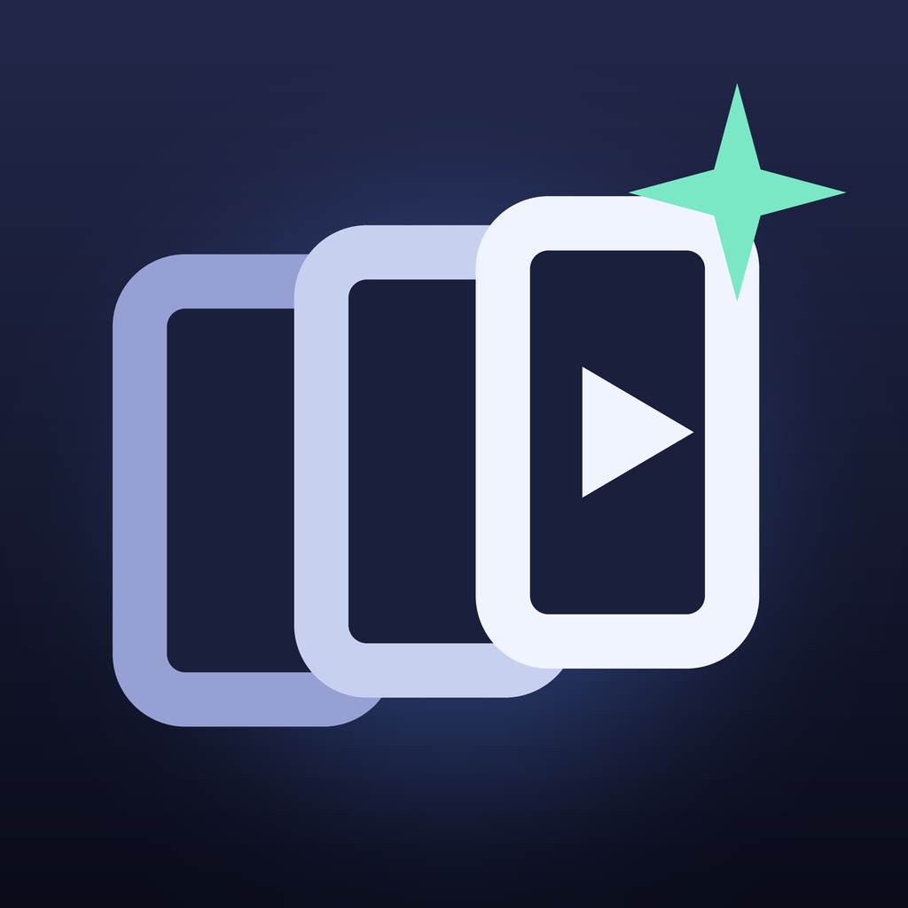

<p align="center"></p>

<h1 align="center">Promo Templates</h1>

<p align="center"><b>Kodla üretilen</b> dikey videolar ve yenilerini yapan <b>Claude Code skill'leri</b>.</p>

<p align="center">
  <a href="https://github.com/ardasnturk/promo-templates/releases/latest"></a>
  
  
  <a href="LICENSE"></a>
</p>

<p align="center"><a href="https://github.com/ardasnturk/promo-studio">Promo Studio</a> · <a href="README.md">English</a> · <b>Türkçe</b></p>

> **Promo Templates, Remotion ve Claude Code ile yapılmıştır.** Bağımsız, açık
> kaynak bir projedir; **Remotion ya da Anthropic ile bağlantılı değildir, onlar
> tarafından onaylanmamış ya da desteklenmemiştir.** Remotion'ın kendi lisansı
> vardır (bkz. [Lisans](#lisans)).

Promo Templates; TikTok, Reels ve Shorts için kısa dikey videolardan oluşan bir
[Remotion](https://www.remotion.dev) projesidir: fizik döngüleri, bulmacalar,
metinsiz makineler, rahatlatıcı egzersizler ve mesajlaşma hikâyeleri. Hepsi
React bileşeni olarak yazılır, hiçbir şey çekilmez. Her video türü aynı zamanda
bir **Claude Code skill'idir**: isteğini yazarsın, Claude yeni bir video
kodlar, kontrol eder ve render eder.

Tek başına Claude Code ile çalışır; aynı zamanda onu kuran, güncel tutan, fikir
bulan ve videoları paylaşan [Promo Studio](https://github.com/ardasnturk/promo-studio)'nun
şablon kütüphanesidir.

## Özellikler

* **Çekim değil kod** — her kare React ve `useCurrentFrame()` ile oluşur; bir
  parametreyi değiştir, yeniden render et.
* **Gerçek simülasyonlar** — bulmacaları gerçek çözücüler (BFS, A*) çözer, fizik
  simüle edilir; aynı `seed` Studio'da ve render'da aynı videoyu verir.
* **15 skill** — `/video-physics`, `/video-puzzle`, `/video-cringe`,
  `/video-relaxing`, on metinsiz format ve trend araştırması için `/video-ideas`.
* **Ortak kurallar** — `CLAUDE.md` her videoyu aynı biçimde tutar: güvenli
  alanlar, kanca ve kapanış, ses, doğrulanmış bilgiler, render öncesi kontrol.
* **Kendi markan** — `src/<UygulamaAdın>/` ekle; Promo Studio onu promosyon
  filmlerinde marka kiti olarak kullanır.

## İçindekiler

* [Hızlı başlangıç](#hızlı-başlangıç)
* [Şablonlar](#şablonlar)
* [Claude Code ile yeni video](#claude-code-ile-yeni-video)
* [Promo Studio ile](#promo-studio-ile)
* [Kendi uygulaman için şablon](#kendi-uygulaman-için-şablon)
* [Notlar](#notlar)
* [Katkıda bulunmak](#katkıda-bulunmak)
* [Lisans](#lisans)

## Hızlı başlangıç

```sh
git clone https://github.com/ardasnturk/promo-templates.git && cd promo-templates
npx remotion skills add          # Remotion'ın resmi agent skill'leri (.agents/skills)
cd templates && npm install
npx remotion studio              # http://localhost:3000 adresinde açılır
```

MP4 almak için Studio'daki **Render** düğmesini kullan ya da:

```sh
npx remotion render <KompozisyonId> out/<ad>.mp4
```

Render çıktıları (`out/`) git'e girmez. Node.js 20 veya üstü gerekir;
skill'ler için kendi hesabınla oturum açılmış
[Claude Code](https://claude.com/claude-code).

## Şablonlar

| Klasör (Studio) | Kompozisyon | Ne görürsün | Kod |
|---|---|---|---|
| Satisfying | `BouncingBall` | Her çarpışta büyüyen top çemberi doldurmaya çalışıyor | `src/BouncingBall` |
| Satisfying | `BallSort` | Renkli toplar tüplere sıralanıyor (BFS çözücü, `seed` prop) | `src/BallSort` |
| Satisfying | `FifteenPuzzle` | 15 bulmacası en az hamleyle çözülüyor (A*, `seed` prop) | `src/Satisfying/FifteenPuzzle` |
| Wordless | `MassMachine` | Metinsiz: topları çoğaltan sarkaç makinesi (`seed`, `maxBalls`) | `src/Wordless/MassMachine` |
| Relaxing | `Breathe` | 4-4-4-4 kutu nefesi | `src/Breathe` |
| Cringe | `CringeChat` | Sevgiliye yazılan mesajlar patrona gidiyor | `src/CringeChat` |

## Claude Code ile yeni video

Bu klasörde Claude Code'u aç; `CLAUDE.md` (ortak kurallar) kendiliğinden
yüklenir. Sonra:

| Komut | Ne üretir |
|---|---|
| `/video-physics [mekanik]` | Tatmin edici fizik döngüsü |
| `/video-puzzle [bulmaca]` | Gerçek çözücüyle bulmaca çözümü |
| `/video-cringe [senaryo]` | Cringe mesajlaşma hikâyesi |
| `/video-relaxing [egzersiz]` | Rahatlatıcı rehberli egzersiz |
| `/video-multiplier`, `/video-chain`, `/video-color-war`, `/video-fill`, `/video-hypnotic`, `/video-elimination`, `/video-growth`, `/video-slice`, `/video-machine`, `/video-swarm` | Metinsiz videolar (`CLAUDE.md` madde 10) |
| `/video-ideas [odak]` | Trend araştırması ve yeni konseptler |

Örnek: `/video-puzzle 8 tüplü top sıralama, zor seviye`

Claude kompozisyonu yazar, tür denetiminden geçirir, kareleri kontrol etmek için
still'ler render eder, sonra videoyu render eder. Kopyala-yapıştır mı tercih
edersin? Aynı istemler [PROMPTS.md](PROMPTS.md) dosyasında (İngilizce).

## Promo Studio ile

[Promo Studio](https://github.com/ardasnturk/promo-studio) ilk açılışta bu
kütüphaneyi kurmayı önerir (var olan bir kopya için **Şablonlar → Kütüphane
ekle…**). Kütüphane ekranında:

* **Üret…** — bir skill seç ve isteğini yaz; Promo Studio Claude Code'u burada
  çalıştırır, render edilen videoyu içe aktarır ve açıklama yazar.
* **Trendleri araştır** — `/video-ideas` konsept önerir; **Bunu üret** ilgili
  skill'i başlatır.
* Parametreleri değiştirip Claude olmadan **yeniden render et**.
* **Güncelle** — Promo Studio kopyanı son sürümle karşılaştırır ve yerel
  değişiklik yoksa git ile günceller.

## Kendi uygulaman için şablon

Bir uygulamaya özel kalıplar (marka renkleri, logo, açılış animasyonu) için
`src/<UygulamaAdı>/` ve `public/<uygulamaadı>/` ekle (ör. `src/Acme/` ve
`public/acme/`). Promo Studio'da aynı adlı bir proje varsa Claude, promosyon
filmi yazarken bu klasörü marka kiti olarak okur. Kişisel ya da gizli marka
varlıklarını kendi özel fork'unda tut.

## Notlar

* Ses efektleri render sırasında `https://remotion.media/` adresinden indirilir;
  render için internet bağlantısı gerekir. Müzik platformda eklenir.
* Simülasyonlar deterministiktir: aynı `seed` Studio'da ve render'da aynı
  sonucu verir.
* Sürümler GitHub Releases'ta yayınlanır; sürüm numarası
  `templates/package.json` içindeki `version` alanıdır.

## Katkıda bulunmak

Yeni şablonlar ve skill'ler memnuniyetle karşılanır — lütfen önce
[CONTRIBUTING.md](CONTRIBUTING.md) dosyasını oku.

## Lisans

[MIT](LICENSE) © 2026 Arda Şentürk. Şablonlar, kendi lisansı olan
[Remotion](https://www.remotion.dev)'ı kullanır: bireyler, kâr amacı gütmeyen
kuruluşlar ve en fazla 3 çalışanlı şirketler için ücretsizdir; daha büyük
şirketlerin [şirket lisansı](https://www.remotion.dev/license) alması gerekir.

"Claude" ve "Claude Code" Anthropic, PBC'nin; "Remotion" Remotion AG'nin;
"TikTok", "Instagram" ve "YouTube" sahiplerinin ticari markalarıdır. Burada
yalnızca uyumluluğu anlatmak için kullanılırlar.
